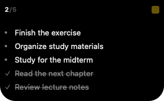
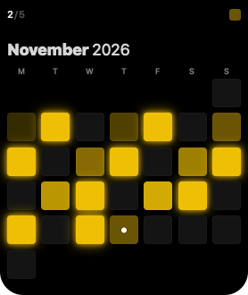

# Glitter

***Turn your days into gold.***

<a href="#en">English</a> · <a href="#cn">简体中文</a>

| Day | Month |
| :---: | :---: |
|  |  |

*Screenshots use fictional tasks. / 截图使用假数据。*

## English

Glitter is a small macOS app that keeps Apple Reminders tasks beside your notch and shows your daily progress in a monthly calendar. It grew out of SAND, an earlier project about time and grains of sand.

- **Local and private.** Glitter makes no direct network requests and includes no analytics or app logs. It saves only your selected list IDs, display and panel position.
- **Works with Apple Reminders.** Reads and updates your reminders through Apple’s on-device API. Task data stays in Reminders, and Apple handles iCloud syncing across your devices.
- **Track your lists.** Choose a list in Settings, or hold ⌘ while clicking to select several. Their tasks and daily progress are combined.
- **Keeps today visible.** Shows today’s tasks and unfinished overdue reminders at the top of your screen. Hover to view them and click to mark them complete. Create and edit tasks in Apple Reminders.
- **Shows your progress.** Eight shades of gold represent daily completion. Days with all tasks completed glow gold.

The calendar uses current reminder records. Editing or deleting those records may change past results.

Read the [privacy details and verification notes](docs/PRIVACY.md).

### Download

Download [Glitter 1.0](https://github.com/uniAspirin/Glitter/releases/download/v1.0/Glitter-1.0.dmg). Requires macOS 14 or later and Apple Silicon.

Open the DMG and drag Glitter to Applications. On first launch, allow Reminders access and choose your lists in Settings. The app is ad-hoc signed and has not been notarized by Apple. macOS may require approval under System Settings → Privacy & Security → Open Anyway.

## 简体中文

Glitter 是一个小型 macOS 应用，将 Apple Reminders 中的任务放在刘海旁，并用月历展示每天的完成情况。它来自之前的项目 SAND，延续了用金色沙粒记录时间的想法。

- **本地处理，保护隐私。** Glitter 不主动联网，没有统计追踪或应用日志。仅保存所选列表 ID、显示器和窗口位置。
- **直接使用苹果提醒事项。** 通过苹果本地 API 读取和更新任务。任务数据保留在提醒事项中，设备间的 iCloud 同步由苹果负责。
- **选择要跟踪的列表。** 在设置中选择一个列表，按住 ⌘ 点击可多选。所选列表的任务与每日进度会合并显示。
- **让今天的任务保持可见。** 在屏幕顶部显示今日任务和未完成的逾期事项。悬停查看，点击完成。创建和编辑仍在提醒事项中进行。
- **看见每天的积累。** 八级金色表示每天的完成比例，全部完成的日子会亮起金色光晕。

月历基于当前提醒事项记录计算。修改或删除原始记录，可能改变过去的显示结果。

查看[隐私说明与检查记录](docs/PRIVACY.md)。

### 下载

下载 [Glitter 1.0](https://github.com/uniAspirin/Glitter/releases/download/v1.0/Glitter-1.0.dmg)。支持 macOS 14 及以上版本，需要 Apple Silicon 芯片。

打开 DMG，将 Glitter 拖入 Applications。首次启动允许提醒事项访问，再在设置中选择列表。应用使用 ad-hoc 签名，尚未经过 Apple 公证。macOS 如阻止首次启动，可在系统设置 → 隐私与安全性中选择“仍要打开”。

[Development / 开发说明](docs/DEVELOPMENT.md) · [Release notes / 版本说明](docs/RELEASE_NOTES.md) · [MIT License](LICENSE)
